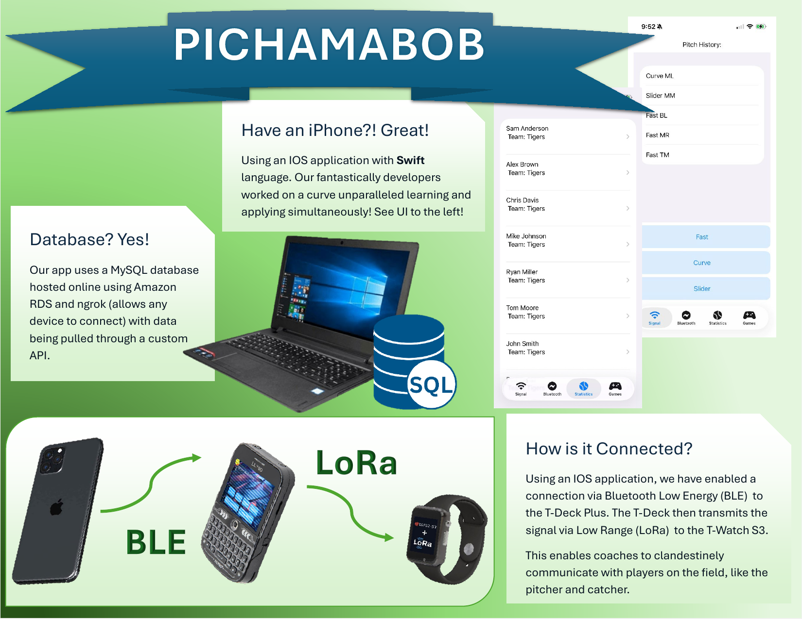
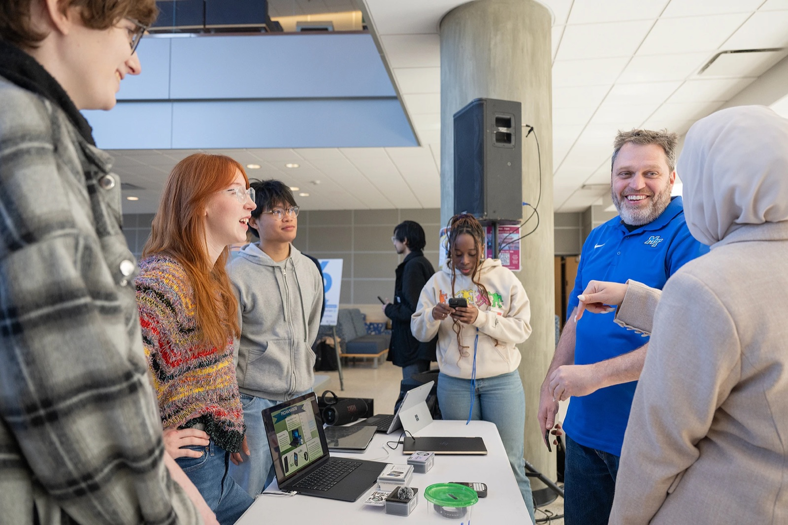

# Pichamabob



**HackMT 2026** — electronic pitch calling for baseball. The coach taps a pitch on an iPhone,
and it shows up on the pitcher's watch over LoRa radio. No cell signal or Wi-Fi needed on the field.

```
 iPhone app ──BLE──▶ T-Deck Plus ──LoRa 915 MHz──▶ T-Watch S3
 (coach)             (relay)                       (player)
     │
     └──HTTP──▶ Backend API ──▶ MySQL   (pitcher stats, games)
```

1. The coach picks a pitch type and a location (e.g. `Fast TL`) in the iOS app.
2. The app writes that text to the T-Deck over Bluetooth Low Energy.
3. The T-Deck transmits it over LoRa.
4. The T-Watch receives it and shows it on screen.

The app's Statistics and Games tabs read from the backend API.

## Repository layout

| Folder | What | Stack |
|---|---|---|
| [`ios/`](ios/) | Coach app: pitch calling, BLE connection, stats | SwiftUI, CoreBluetooth |
| [`firmware/tdeck-relay/`](firmware/tdeck-relay/) | BLE → LoRa relay | PlatformIO, Arduino, RadioLib |
| [`firmware/twatch-receiver/`](firmware/twatch-receiver/) | Watch that displays the call | PlatformIO, Arduino, RadioLib, Adafruit ST7789 |
| [`backend/`](backend/) | REST API for pitches, pitchers, games | .NET 8, MySQL |
| [`docs/`](docs/) | [Poster](docs/poster.pdf), [project overview](docs/project-overview.pdf) | |

Each folder has its own README with setup steps.

## Running the full demo

1. Flash the watch and the T-Deck (see [firmware/README.md](firmware/README.md)).
2. Optional: start the backend (see [backend/README.md](backend/README.md)) and put its URL in the app.
3. Run the iOS app on a real iPhone (Bluetooth doesn't work in the simulator), then go to **Bluetooth → Connect**.
4. Go to **Signal**, pick a pitch, then a location. The call appears on the watch.

## Team



| Area | People |
|---|---|
| iOS app | Allison O'Brien, Madeleine Butuli |
| Firmware | Emily Tew ([@et4v](https://github.com/et4v)), Rachel Bell ([@bell-rachel](https://github.com/bell-rachel)) |
| Backend | James Nguyen ([@jtnguyen3](https://github.com/jtnguyen3)), Jackson Reed ([@j9cks](https://github.com/j9cks)) |
| Mentor | Matthew Radice |

Built at HackMT, January 31 – February 1, 2026.

A big thank you to **Matthew Radice**, who came up with the idea for Pichamabob and mentored us
through the weekend. He deliberately stepped back so the rest of us could own the project, and
he was there with guidance whenever we got stuck, all while balancing his PhD work.

## About this repo

During the hackathon, none of us really knew how to use GitHub yet. The code ended up spread
across several personal repos, laptops and files that were never committed, and the working
demo was never all in one place.

This repo was put together afterward, in October 2026, so there's a record of the project.
The code is what ran at the demo. Unused leftovers were removed and passwords were kept out,
but nothing was rewritten. The backend originally lived at
[jtnguyen3/hackMT11](https://github.com/jtnguyen3/hackMT11).
